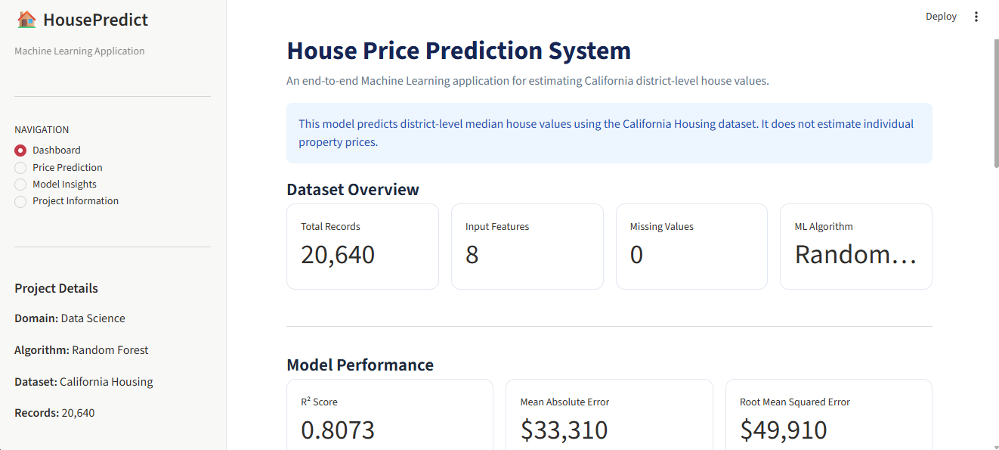
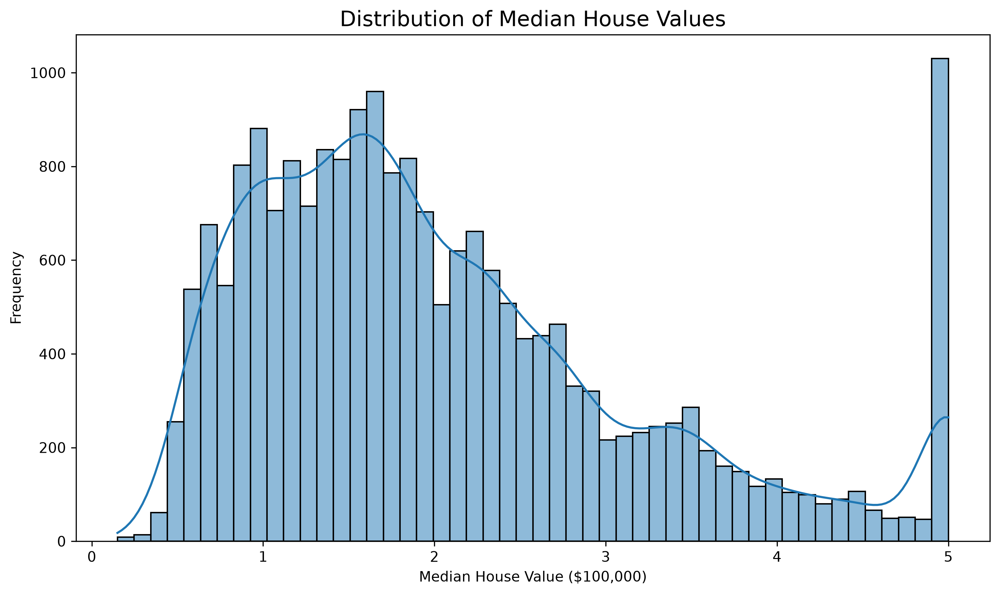
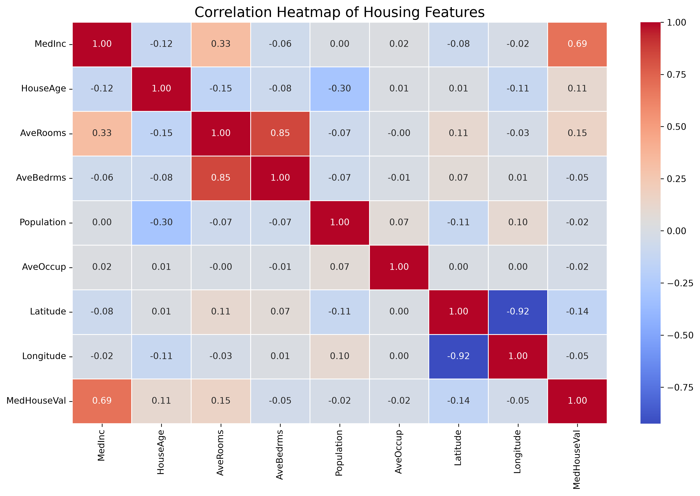
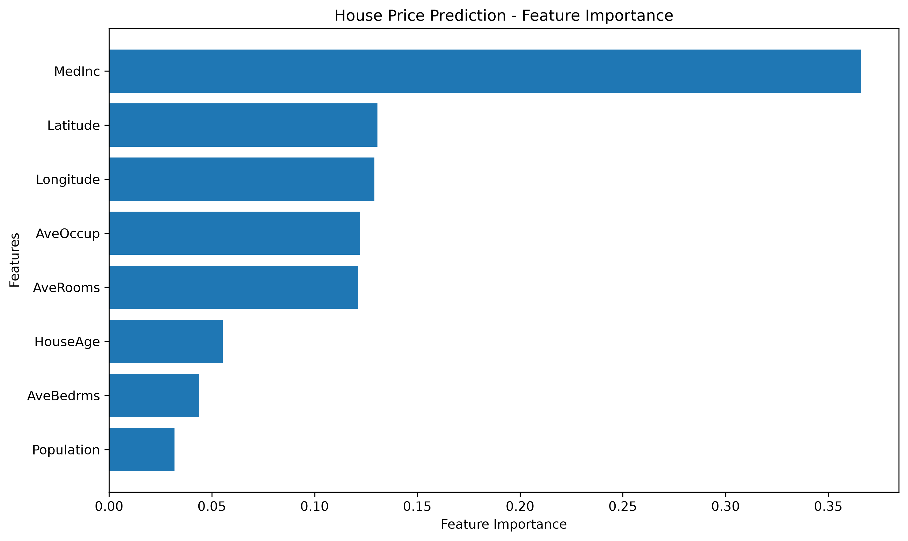
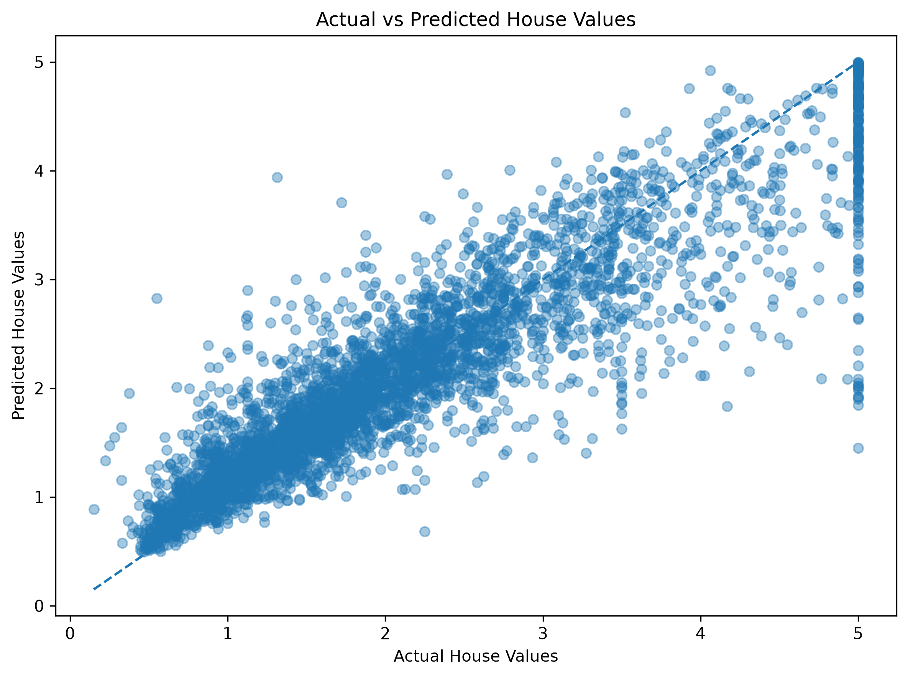

# 🏡 House Price Prediction System

An end-to-end Machine Learning project that predicts California house values using housing and geographical features. The project includes data analysis, preprocessing, model training, evaluation, and an interactive Streamlit dashboard.

## 📌 Project Overview

The House Price Prediction System uses Machine Learning algorithms to estimate median house values based on features such as median income, house age, average rooms, population, and geographical location.

The goal is to build a complete, practical ML application with an easy-to-use interface.

## 🎯 Project Objectives

- Analyze housing data using Exploratory Data Analysis (EDA).
- Clean and preprocess the dataset.
- Train and compare multiple Machine Learning models.
- Tune the Random Forest model.
- Evaluate model performance using standard metrics.
- Build an interactive Streamlit dashboard.
- Allow users to enter property-related features and receive price predictions.

## 📊 Dataset Information

**Dataset:** California Housing Dataset  
**Source:** Scikit-learn

- Total Records: 20,640
- Input Features: 8
- Target Variable: MedHouseVal

### Features

| Feature | Description |
|---|---|
| MedInc | Median income |
| HouseAge | Median house age |
| AveRooms | Average rooms |
| AveBedrms | Average bedrooms |
| Population | Population |
| AveOccup | Average occupancy |
| Latitude | Latitude |
| Longitude | Longitude |

**Note:** The target variable is measured in units of $100,000. For example, 4.526 represents approximately $452,600.

## 🛠️ Technologies Used

- Python
- Pandas
- NumPy
- Matplotlib
- Seaborn
- Scikit-learn
- Joblib
- Streamlit
- Jupyter Notebook
- Git & GitHub

## 🔄 Project Workflow

1. Dataset Collection
2. Data Exploration and Analysis
3. Data Cleaning and Preprocessing
4. Train-Test Split
5. Model Training
6. Model Comparison
7. Cross-Validation
8. Hyperparameter Tuning
9. Feature Importance Analysis
10. Final Model Evaluation
11. Streamlit Dashboard Development

## 🤖 Machine Learning Models

The following algorithms were evaluated:

- Linear Regression
- Decision Tree Regressor
- Random Forest Regressor

Random Forest performed best among the evaluated models.

## 📈 Model Performance

Final Random Forest model evaluation:

| Metric | Result |
|---|---:|
| R² Score | 0.8073 |
| MAE | 0.3331 |
| RMSE | 0.4991 |

MAE and RMSE are measured in units of $100,000.

The R² score indicates that the model explains approximately 80.73% of the variation in the test dataset.

## ⭐ Feature Importance

The most influential features in the trained Random Forest model were:

1. MedInc
2. Latitude
3. Longitude
4. AveOccup
5. AveRooms

## 📊 Exploratory Data Analysis

The project includes visualizations for:

- House Price Distribution
- Correlation Heatmap
- Geographical Analysis
- Outlier Analysis
- Feature Importance
- Actual vs Predicted Values
- Residual Analysis

## 🖥️ Streamlit Dashboard

The interactive dashboard includes four sections:

- Dashboard
- Price Prediction
- Model Insights
- Project Information

Users can enter housing features and get an estimated house value.

## 📸 Project Screenshots

### Dashboard Home


### House Price Distribution


### Correlation Heatmap


### Feature Importance


### Actual vs Predicted


## ⚙️ Installation and How to Run

### 1. Clone the Repository

```bash
git clone YOUR_GITHUB_REPOSITORY_URL
```

### 2. Navigate to the Project Folder

```bash
cd House-Price-Prediction-System
```

### 3. Create a Virtual Environment

```bash
python -m venv venv
```

### 4. Activate the Environment

Windows PowerShell:

```powershell
venv\Scripts\activate
```

### 5. Install Dependencies

```bash
pip install -r requirements.txt
```

### 6. Run the Streamlit Application

```bash
python -m streamlit run app.py
```

The dashboard will open in your browser.

## 📁 Project Structure

```text
House-Price-Prediction-System/
│
├── app.py
├── requirements.txt
├── README.md
├── .gitignore
│
├── data/
│   ├── raw/
│   └── processed/
│
├── notebooks/
│   └── 01_EDA.ipynb
│
├── src/
│   ├── download_data.py
│   ├── data_preprocessing.py
│   ├── train_model.py
│   ├── model_validation.py
│   ├── model_tuning.py
│   ├── feature_importance.py
│   └── final_evaluation.py
│
├── models/
│   ├── best_house_price_model.pkl
│   ├── tuned_house_price_model.pkl
│   └── final_house_price_model.pkl
│
├── reports/
│   └── figures/
│
└── screenshots/
    └── dashboard_home.png
```

## ⚠️ Limitations

- The dataset represents California housing data, not Indian or Gurgaon property prices.
- Predictions are based on district-level aggregate features, not individual property inspections.
- The model is intended for educational and analytical purposes, not official property valuation.

## 🚀 Future Improvements

- Integrate real-time housing data.
- Experiment with advanced regression algorithms.
- Improve prediction accuracy through additional features.
- Deploy the application online.
- Extend the project to other geographical regions.

## 👩‍💻 Author

**Bhanu**

B.Tech in Computer Science and Engineering | 2026 Graduate

Data Science | Machine Learning | Python | SQL | Power BI

---

⭐ If you find this project interesting, feel free to explore the repository!
